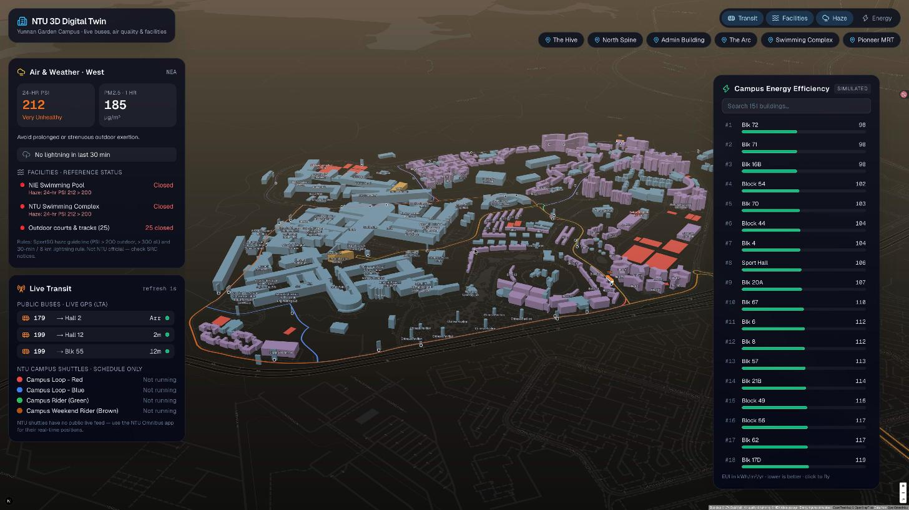
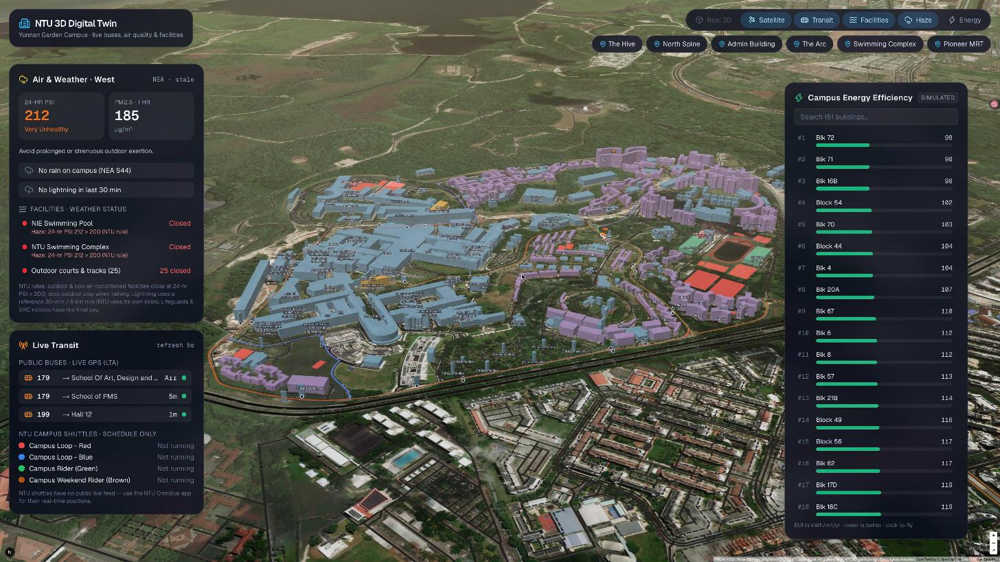
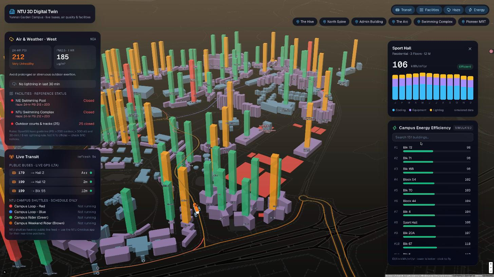
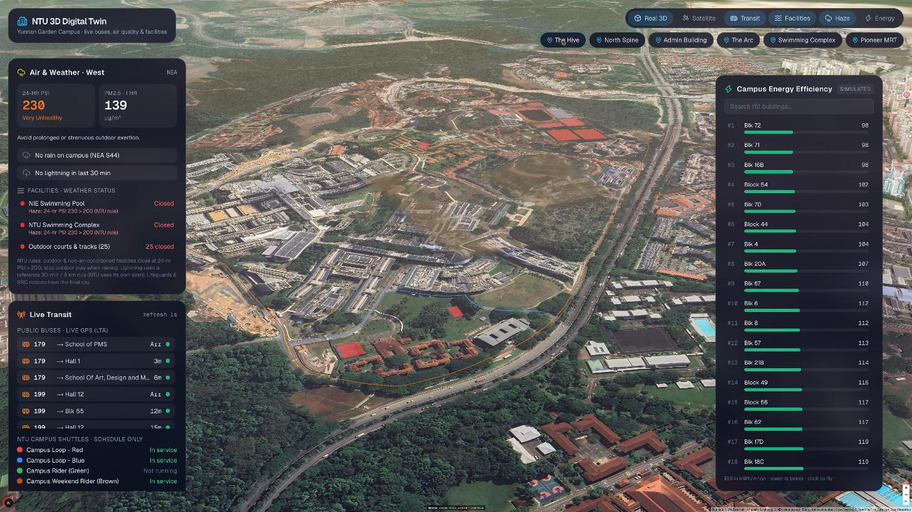
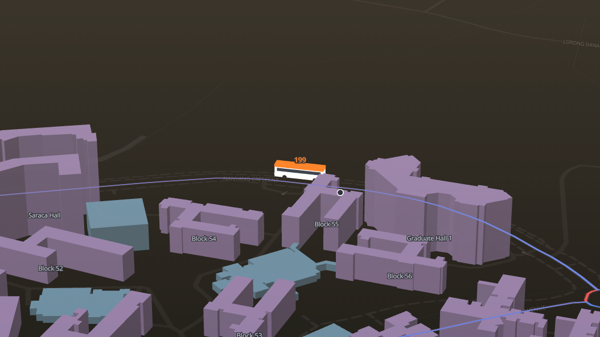

# Build a 3D NTU Campus Digital Twin with Live Transit, Haze & Weather Awareness



An NTU (Nanyang Technological University, Singapore) adaptation of [jarrettyeo/nus-digital-twin-map-workshop](https://github.com/jarrettyeo/nus-digital-twin-map-workshop). The architecture, file layout and spec-driven workflow follow the original NUS codelab. The data layer is rebuilt for NTU, and the haze, lightning, facility and real-world imagery features are new.

## Overview & Objectives

You will build an interactive geospatial command center for NTU's Yunnan Garden campus:

1. **Interactive 3D campus**: MapLibre GL JS with real OpenStreetMap building footprints and floor counts for the 354 buildings inside NTU's campus boundary. It includes building labels, lighting, and a satellite imagery basemap.
2. **Live public buses (real GPS)**: Services 179 and 199 come from the official **LTA DataMall** Bus Arrival API, which returns real GPS fixes. That is more precise than the ETA-derived estimates in the NUS original. Buses render as Three.js 3D models.
3. **NTU campus shuttles**: Campus Loop Red/Blue, Campus Rider and Campus Weekend Rider show their routes and stops from OSM, plus timetable-based service status. NTU publishes no live shuttle feed, so the app never draws fake vehicles.
4. **Haze & weather awareness**: Live **24-hr PSI**, **PM2.5**, **rain at the on-campus NEA gauge** and **lightning strikes** come from data.gov.sg. A smog layer thickens with PSI, and the swimming pools and outdoor courts get open/closed status from **NTU's own published rules**.
5. **Campus energy analytics**: EUI pillars, a ranked efficiency chart and a 12-month breakdown. *The energy figures are simulated* (as in the original): no public per-building energy data exists.
6. **Real 3D mode (optional)**: Google Photorealistic 3D Tiles, with routes, buses and facilities draped onto the photogrammetry mesh.

| Satellite mode | Energy mode |
|---|---|
|  |  |

| Real 3D mode (Google Photorealistic 3D Tiles) | Live 3D bus |
|---|---|
|  |  |

### System Architecture & Data Pipeline

```
 ┌────────────────────────────── Data sources ──────────────────────────────┐
 │ OpenStreetMap (Overpass)   LTA DataMall          NEA via data.gov.sg      │
 │  buildings · facilities     v3 BusArrival         PSI · PM2.5 · rainfall   │
 │  shuttle & bus routes       (live GPS, load)      lightning                │
 │        │ one-off snapshot          │ 20 s cache          │ 60 s cache       │
 │        ▼ scripts/fetch-osm.ts      │                     │                  │
 │   data/*.json (committed)          │                     │   Google Map     │
 └────────┼───────────────────────────┼─────────────────────┼───Tiles API─────┘
          ▼                           ▼                     ▼        │ (browser)
 ┌──────────────────────── Next.js 16 route handlers ─────────────────┼──────┐
 │ /api/buildings  /api/facilities  /api/transit/stops   ('use cache')│      │
 │ /api/transit/buses  /api/environment                  (request time)      │
 │ lib/digitaltwin.ts  lib/transit.ts  lib/environment.ts                    │
 └────────────────────────────────────┬──────────────────────────────┼──────┘
                                      ▼                              ▼
 ┌──────────────────────── Client (MapLibre GL + Three.js + deck.gl) ─────────┐
 │ 3D buildings · energy pillars · routes · facilities · lightning · haze     │
 │ Three.js 3D buses │ satellite raster │ Google 3D tiles + draped overlays   │
 │ HUD: Air & Weather · Live Transit · Energy chart · Building inspector      │
 └────────────────────────────────────────────────────────────────────────────┘
```

### What changed vs. the NUS original

| NUS original | NTU version | Why |
|---|---|---|
| `nus-digital-twin.com` buildings API (points only) | OSM snapshot of real footprints and floor counts inside the campus boundary | No NTU equivalent exists. OSM gives real shapes instead of 36 m squares |
| NUS transit proxy (ETA-estimated positions) | LTA DataMall v3 BusArrival (real GPS) | No NTU shuttle feed exists, while LTA gives real coordinates for public buses |
| `export const revalidate = 3600` | `'use cache'` + `cacheLife('hours')` | Next.js 16 with `cacheComponents` rejects route segment configs |
| `import maplibregl from 'maplibre-gl'` | `import * as maplibregl` + `setWorkerUrl` | MapLibre v6 has no default export, and Turbopack breaks its worker URL |
| — | Haze, rain, lightning and facility status | Real-time NEA data and NTU's published rules |
| — | Satellite & Google Photorealistic 3D | Real-world imagery |

---

## Data Sources & API Reference

### 1. LTA DataMall: Bus Arrival v3 (live GPS)
* **Endpoint**: `https://datamall2.mytransport.sg/ltaodataservice/v3/BusArrival?BusStopCode=<code>`
* **Auth**: header `AccountKey: <LTA_ACCOUNT_KEY>`. The key is free: [request one here](https://datamall.lta.gov.sg/content/datamall/en/request-for-api.html). Only the **API Account Key** is needed. The *Extended OBU Library SDK* key LTA may also send is for in-vehicle ERP units and is not used here.
* **Response**: `Services[].NextBus{,2,3}` with `EstimatedArrival`, `Monitored` (1 = live GPS), `Latitude`/`Longitude` (strings, `"0.0"` when unmonitored), `Load` (`SEA`/`SDA`/`LSD`) and `Type` (`SD`/`DD`/`BD`).
* **How we use it**: we poll 9 in-campus stops (`27011 27031 27051 27061 27211 27241 27261 27281 27311`), keep services 179/179A/179B/199, and dedupe each bus by service and coordinates (the same bus appears at several stops). Results are cached server-side for 20 s, which works out to roughly 27 requests per minute.

### 2. NEA real-time data (data.gov.sg, no key required)
| Data | Endpoint | Field used |
|---|---|---|
| PSI | `https://api-open.data.gov.sg/v2/real-time/api/psi` | `psi_twenty_four_hourly.west` (NTU is in the **west** region) |
| PM2.5 | `https://api-open.data.gov.sg/v2/real-time/api/pm25` | `pm25_one_hourly.west` |
| Rain | `https://api-open.data.gov.sg/v2/real-time/api/rainfall` | station **S44 Nanyang Avenue** (on campus), mm per 5 min |
| Lightning | `https://api-open.data.gov.sg/v2/real-time/api/weather?api=lightning&date=<SGT>` | `records[].item.readings[]` → `{ location, type: C/G, datetime }` |

data.gov.sg rate-limits anonymous bursts (HTTP 429 after about 5 quick calls). The server caches results for 60 s and falls back to the last good reading (shown as *stale*). An optional `DATA_GOV_API_KEY` raises the limit.

### 3. Facility status rules
| Trigger | Rule | Source |
|---|---|---|
| Haze | Outdoor and non-air-conditioned sports facilities **close when 24-hr PSI > 200** | **NTU official**: [NTU Haze Response Guidelines](https://www.ntu.edu.sg/life-at-ntu/health-and-safety/ntu-haze-response-guidelines) |
| Rain | Stop outdoor play "when it is raining"; evacuate the pool in "inclement weather" | **NTU official** wording: [SRC Eligibility & Usage](https://www.ntu.edu.sg/life-at-ntu/recreational-spaces-facilities/sports-recreation-centre/eligibility-usage). Implemented as rain > 0 mm at S44 in the latest 5 min |
| Lightning | Strike within **8 km** in the last **30 min** → outdoor closed | **Reference only**. NTU uses its own lightning siren and publishes no distance or time. Adjust `RULES` in `lib/environment.ts` |

> [!IMPORTANT]
> The app shows an *advisory* status computed from public data. Lifeguards and SRC notices always have the final say.

### 4. OpenStreetMap snapshot
`scripts/fetch-osm.ts` queries Overpass once and writes `data/ntu-buildings.json`, `data/ntu-facilities.json` and `data/ntu-transit.json`. Overpass frequently returns 502/504, so the script retries with back-off and the app **never calls Overpass at runtime**. Key OSM IDs: campus boundary way `115105262`; shuttle relations CL-R `2571769`, CL-B `2571810`, CR `2571820`, CWR `19791593`; bus relations 179 `1155343`, 199 `1157111`.

### 5. Imagery
* **Satellite**: Esri World Imagery raster tiles (no key; attribution "Imagery © Esri, Maxar, Earthstar Geographics").
* **Real 3D**: [Google Photorealistic 3D Tiles](https://developers.google.com/maps/documentation/tile/3d-tiles) (`https://tile.googleapis.com/v1/3dtiles/root.json`). Requires a Google Maps Platform key with the **Map Tiles API** enabled and billing set up (there is a monthly free quota). Per the [Map Tiles API policies](https://developers.google.com/maps/documentation/tile/policies), the Google logo and the per-viewport data credits are shown in their own box, and tiles are never cached or stored.

---

## Environment Setup

### 1. Prerequisites
* Node.js 20+ and npm
* An AI coding agent with workspace rules and a planning mode: **Google Antigravity** (as in the original codelab) or **Claude Code**. `CLAUDE.md` imports the same rules file.

### 2. Scaffold the project

```bash
npx create-next-app@latest ntu-digital-twin --typescript --tailwind --no-eslint --app --src-dir=false --import-alias="@/*" --use-npm --yes
cd ntu-digital-twin
npm install maplibre-gl three @types/three lucide-react dotenv
npm install @deck.gl/core @deck.gl/layers @deck.gl/geo-layers @deck.gl/mapbox @deck.gl/extensions
npm install -D tsx @types/node
```

Then add the MapLibre worker copy step (see *Troubleshooting*):

```bash
npm pkg set scripts.postinstall="node -e \"require('fs').copyFileSync('node_modules/maplibre-gl/dist/maplibre-gl-worker.mjs','public/maplibre-gl-worker.mjs')\""
npm run postinstall
```

### 3. Environment variables (`.env.local`)

```bash
cp .env.example .env.local
```

| Variable | Required | Where to get it |
|---|---|---|
| `LTA_ACCOUNT_KEY` | Yes (live buses) | [LTA DataMall](https://datamall.lta.gov.sg/content/datamall/en/request-for-api.html), usually emailed within a day |
| `LTA_DATAMALL_API` | Yes | `https://datamall2.mytransport.sg/ltaodataservice` |
| `DATA_GOV_API_KEY` | Optional | [data.gov.sg](https://data.gov.sg) developer portal |
| `NEXT_PUBLIC_GOOGLE_MAPS_API_KEY` | Optional (Real 3D) | Google Cloud Console → enable **Map Tiles API** → create an API key → restrict it by HTTP referrer |

`.env.local` is git-ignored, so never commit real keys.

### 4. Workspace rules (`.agents/rules/workspace.md`)
The rules file is the spec your agent builds from. It pins the campus coordinates, every API contract, the caching rules for Next.js 16, the MapLibre v6 pitfalls, the facility rules and the rendering conventions. Copy [`.agents/rules/workspace.md`](.agents/rules/workspace.md) from this repo into your project. With Claude Code, also copy `CLAUDE.md`.

---

## Phase 0: Snapshot NTU Geodata

```bash
npx tsx scripts/fetch-osm.ts                      # everything
npx tsx scripts/fetch-osm.ts --only=facilities    # just one part (Overpass is flaky)
```

Expected output: about 354 buildings (162 named), 33 facilities (5 pools), and 6 routes with 65 stops.

## Phase 1: Architecture Blueprint with `/plan`

In Antigravity use `/plan`; in Claude Code use plan mode. Prompt:

```text
/plan Generate a comprehensive implementation plan to build the NTU 3D Campus Digital Twin according to our .agents/rules/workspace.md.
Detail the file creations and verification steps for:
1. `lib/types.ts`: BuildingEnergy, CampusBuilding, ShuttleEta, BusStop, ActiveBus, CampusRoute, TransitState, EnvironmentState, FacilityStatus, LightningStrike.
2. `lib/digitaltwin.ts`: read data/ntu-buildings.json, derive height (height tag → levels × 4 m → hashed 10–30 m), category, and a simulated 12-month EUI (cooling 55%, equipment 30%, lighting 15%).
3. `lib/transit.ts`: stops/routes GeoJSON from data/ntu-transit.json; live buses from LTA v3 BusArrival over the 9 campus stops with a 20 s in-memory cache, Monitored===1 only, deduped, with bearing/arc snapped to the route; NTU shuttle timetable status.
4. `lib/environment.ts`: NEA PSI (west), PM2.5, S44 rainfall and lightning; last-good fallback on HTTP 429; facility status from the RULES block (NTU haze > 200, NTU rain rule, reference 30-min/8 km lightning rule).
5. Route handlers: /api/buildings, /api/facilities, /api/transit/stops ('use cache' + cacheLife('hours') helpers); /api/transit/buses and /api/environment (await connection()).
6. `components/MapCanvas.tsx`: MapLibre v6 + OpenFreeMap dark, satellite raster under labels, setLight, building labels, facilities, lightning, haze sky + CSS overlay, layer toggles, ref-synced sources.
7. `lib/threeBusLayer.ts`: Three.js custom layer anchored at [103.6835, 1.3455] with 2.5x buses.
8. `lib/photorealistic.ts`: Google Photorealistic 3D Tiles via deck.gl Tile3DLayer (operation 'terrain+draw') with TerrainExtension-draped overlays and Google attribution.
9. HUD components: BusTracker, EnvironmentPanel, CampusEnergyChart, BuildingEnergyModal, LayerToggles.
10. `app/page.tsx`: client page; fetch in useEffect; poll buses every 5 s and environment every 60 s; MapCanvas via dynamic(..., { ssr: false }).
```

Review the generated `implementation_plan.md` (this repo includes one), then let the agent implement it.

## Phase 2: Inspect the Architecture

* **`lib/transit.ts`** dedupes LTA buses and snaps each one to its route polyline to get a heading. The same bus is reported by every stop it is approaching.
* **`lib/environment.ts`** keeps all the closure rules in a single `RULES` object. Closures are computed from *all* lightning strikes; the map only receives the latest 500 (one storm on 1 Oct 2026 produced more than 10,000 strikes in 30 minutes).
* **`lib/threeBusLayer.ts`** renders in local metres around the campus centre, so 32-bit float shaders keep full precision.
* **`lib/photorealistic.ts`** uses `operation: 'terrain+draw'`, which makes Google's mesh the terrain that the other deck.gl layers drape onto.

## Phase 3: Launch & Test

```bash
npm run dev
```

Open http://localhost:3000 and check:
1. **Live Transit** lists 179/199 buses (from about 05:30 to 00:30). Click one to fly to its 3D model.
2. **Air & Weather** shows PSI, PM2.5, campus rain and lightning. When PSI is above 200, the pools and outdoor courts turn red.
3. **Layer toggles**: Real 3D, Satellite, Buildings, Transit, Facilities, Haze and Energy. Turning on Satellite hides our building models by default, since the imagery already shows the real rooftops; the **Buildings** button brings them back. Picking a building in the energy chart turns on the pillars and opens its 12-month profile.
4. Landmark buttons fly to The Hive, North Spine, the Admin Building, The Arc, the Swimming Complex and Pioneer MRT.

To verify the lightning logic without waiting for a storm, replay a past one by mocking `Date.now` (for example `2026-10-01T15:30:00+08:00`, when a storm passed directly over NTU) and calling `getEnvironment()`.

## Phase 4: Real 3D (Google Photorealistic 3D Tiles)

1. In [Google Cloud Console](https://console.cloud.google.com/), create a project and enable billing (the free monthly quota covers personal use).
2. Enable **Map Tiles API**.
3. Create an **API key** and restrict it to **HTTP referrers** (`http://localhost:3000/*` and your deployed domain) and to the Map Tiles API.
4. Put it in `.env.local` as `NEXT_PUBLIC_GOOGLE_MAPS_API_KEY`, then restart `npm run dev` (`NEXT_PUBLIC_` variables are read at startup).
5. Open the app at **http://localhost:3000** (the referrer must match the key restriction) and click **Real 3D**. Our own extrusions, labels and Three.js buses are hidden. Routes, stops, facilities and lightning are re-drawn by deck.gl and draped onto Google's mesh, and the live buses stay 3D models sitting on the real roads. Switching off restores the normal view.

> [!TIP]
> When you create the key, Google's console accepts `localhost:3000/*` but may reject raw-IP referrers such as `127.0.0.1`. A brand-new key or restriction can return HTTP 403 for a few minutes until it propagates.

## Phase 5: Supercharge the UI with Skills & `/grill-me`

As in the original codelab, install the design skills and let the agent interview you before restyling:

```bash
npx skills add Leonxlnx/taste-skill -y
```

```text
/grill-me I want to redesign the NTU digital twin command center (app/page.tsx, components/*) using our installed taste skills.
```

## Phase 6 (Optional): Deploy to Vercel

```bash
npm i -g vercel
vercel
```

Add `LTA_ACCOUNT_KEY`, `LTA_DATAMALL_API` and, optionally, `DATA_GOV_API_KEY` and `NEXT_PUBLIC_GOOGLE_MAPS_API_KEY` under **Project → Settings → Environment Variables**, then redeploy. Add the Vercel domain to the Google key's referrer list.

---

## Troubleshooting

| Symptom | Cause | Fix |
|---|---|---|
| Map is black, console shows `Worker failed to load` | Turbopack bundles MapLibre v6, which breaks its relative worker URL | `postinstall` copies the worker to `public/`, and `maplibregl.setWorkerUrl('/maplibre-gl-worker.mjs')` points to it |
| Map is black, no errors, panels show data | MapLibre sets `position: relative` on its container, overriding `absolute inset-0` (height 0) | Put the absolute sizing on a wrapper div |
| `Module has no default export` for maplibre-gl | MapLibre v6 is ESM-only | `import * as maplibregl from 'maplibre-gl'` |
| Build error about `revalidate` / `dynamic` exports | Next.js 16 `cacheComponents` | Use `'use cache'` + `cacheLife()` in a helper function |
| `Overpass HTTP 502/504` | Public Overpass is overloaded | The script retries; rerun with `--only=…` |
| Overpass `406 Not Acceptable` | Missing User-Agent / POST blocked | The script uses GET with a `User-Agent` header |
| Air & Weather shows "stale" or "unavailable" | data.gov.sg 429 rate limit | Wait a minute, or set `DATA_GOV_API_KEY` |
| A giant red polygon over campus | Running tracks are mapped as open lines in OSM | The script keeps only closed rings |
| Real 3D on, but the HUD panels disappear | deck.gl's canvas lives inside MapLibre's control container (`z-index: 2`) | Give the HUD, haze overlay and Google attribution an explicit z-index (`z-10` / `z-[3]` / `z-[5]`) |
| Page feels sluggish, GPU busy while idle | A custom layer calling `map.triggerRepaint()` inside `render()` keeps MapLibre redrawing at 60 fps forever (the original workshop pattern) | Repaint only when bus data changes (`setBuses`). Also skip `setData` for sources whose input did not change. Idle draw calls went from about 40,000/s to 0 |
| Blocked cross-origin `/_next/hmr` from 127.0.0.1 | Next.js 16 dev-origin protection | `allowedDevOrigins: ['127.0.0.1']` in `next.config.ts` |

## Credits & Disclaimer

* Original workshop: [jarrettyeo/nus-digital-twin-map-workshop](https://github.com/jarrettyeo/nus-digital-twin-map-workshop)
* Map data © [OpenStreetMap](https://www.openstreetmap.org/copyright) contributors, basemap by [OpenFreeMap](https://openfreemap.org)
* Bus data © LTA DataMall, under the [Singapore Open Data Licence](https://data.gov.sg/open-data-licence)
* Air quality, rainfall and lightning © NEA via [data.gov.sg](https://data.gov.sg)
* Satellite imagery © Esri, Maxar, Earthstar Geographics · Photorealistic 3D © Google
* Energy figures are **simulated**. Facility status is an **advisory** derived from public data and NTU's published rules, not an official NTU service. This project is not affiliated with NTU or LTA.
